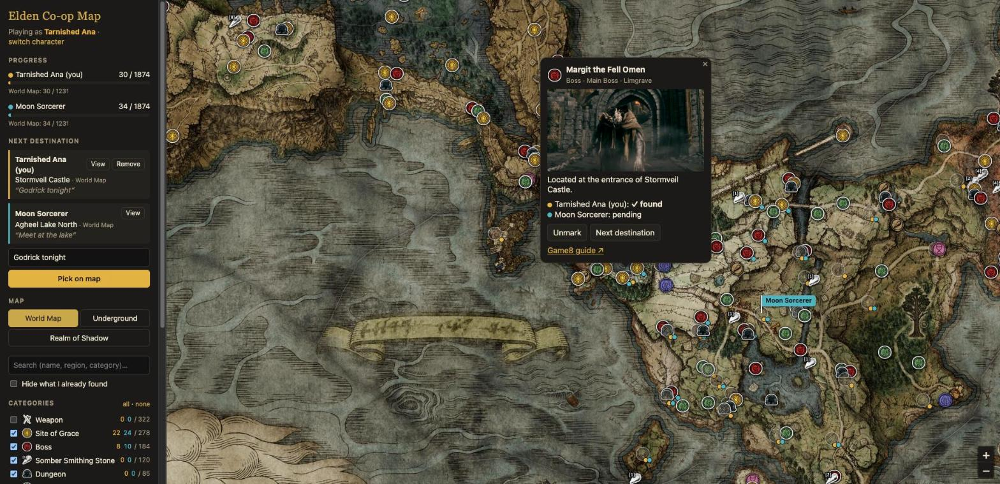
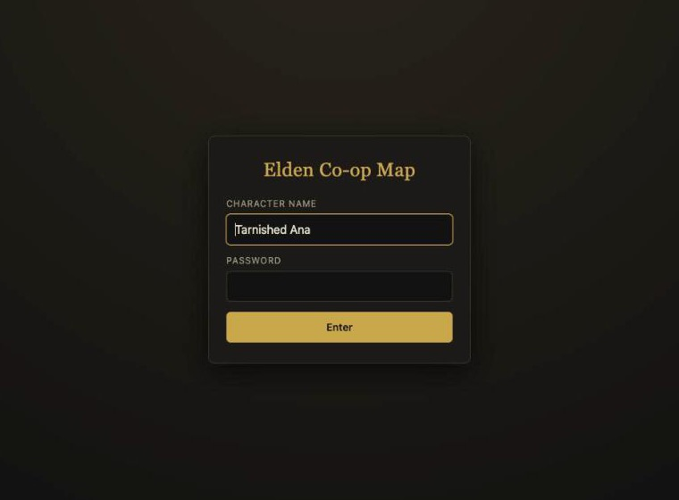
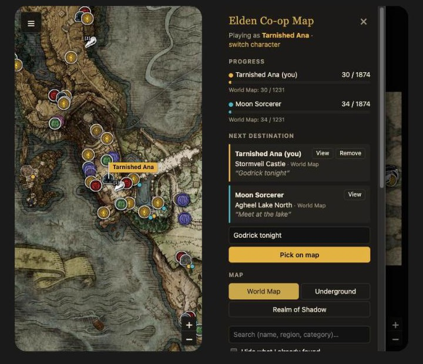

# Elden Co-op Map

Interactive Elden Ring map, solo or in co-op teams of up to three players. Each player marks what they find, sees the progress and next destination of everyone in the team, and sets their own next destination on the map. Changes sync within a few seconds. Anyone can watch a team without marking anything.

Built with **Next.js 16** (App Router), React 19, TypeScript, Leaflet (react-leaflet) and zustand. Pages and API live in a single project.

## Screenshots



| Login | Phone: full-screen map and the actions drawer |
| --- | --- |
|  |  |

The screenshots use demo data: two players with some Limgrave pins found and a next destination each.

## Getting started

```sh
npm install
cp .env.example .env    # set MONGODB_URI and SESSION_SECRET
npm run dev             # http://localhost:3000
```

Open `http://localhost:3000`. From the lobby you can **play solo** (no account, nothing leaves the browser), go back to **your teams** with one click, **create a team**, or pick a team from the list to **join** it (with its password) or **watch** it.

To let other players join from their machines, run `npm run dev -- -H 0.0.0.0` and share `http://<your-ip>:3000`.

| Script | What it does |
| --- | --- |
| `npm run dev` | Development server |
| `npm run typecheck` | TypeScript type check |
| `npm test` | Tests for the sync format, teams and relay (teams use an in-memory MongoDB, downloaded on the first run) |
| `npm run build` | Production build |
| `npm start` | Serves the build (`-- -p 8080 -H 0.0.0.0` for another port or the network) |

## Configuration (`.env`)

| Variable | Purpose |
| --- | --- |
| `MONGODB_URI` | MongoDB connection string (MongoDB Atlas works; on Vercel allow its IPs in Atlas → Network Access). Needed for teams; solo play works without it |
| `MONGODB_DB` | Optional database name. Defaults to `eldencoop` |
| `SESSION_SECRET` | Signs the session cookies, at least 16 characters. Changing it logs everyone out |
| `TILE_URL` | Optional tile URL template (`{map}`, `{z}`, `{x}`, `{y}`). Defaults to `/tiles/{map}/{z}_{x}_{y}.jpg` |

Variables are only read on the server. None has the `NEXT_PUBLIC_` prefix, so they never reach the browser.

## Phones

On screens up to 800px wide the map takes the whole screen. Every action lives in a drawer opened with the button in the top-left corner; tap outside it, press × or start "Pick on map" to close it. Zoom controls sit at the bottom right, touch targets are at least 40px, inputs use 16px text so iOS does not zoom in, and the layout respects the notch and home indicator (`viewport-fit=cover` + `env(safe-area-inset-*)`).

## Overlay over the game

`overlay/` holds a Windows desktop app that shows the map over Elden Ring with a keyboard shortcut (`\`), without touching the game process. See [overlay/README.md](overlay/README.md).

## Teams

- `/` is the lobby, `/solo` the map on your own, `/team/<id>` the page to join or watch a team (the link the host shares) and `/map` the map of your team. Unknown routes return 404.
- **Creating a team:** a name (up to 10 characters; names can repeat, the id is the MongoDB ObjectId) and your name. The server generates a **6-letter password** (A–Z without I and O) and a **creator key**, and you become player 1. The password is shown to share it; the creator key stays in your browser only.
- **Joining:** the team password (case does not matter) and your name. Up to **3 players** per team. Names are unique within a team. The same browser joining again gets its old slot back.
- **Watching:** any team, from the lobby or its link, with **no password and no name**. Spectators see every player's progress and next destination but cannot mark anything; the server rejects any snapshot they send. Up to 20 spectators per team (per server instance on Vercel, so it is approximate).
- **Removing players:** only the browser that created the team, which holds the creator key, sees "Remove from team" on the other players' cards. It removes the player and **bans their browser** (a random id created by each browser). It does not stop them from joining again from another browser. The creator key only travels in that request, and it is included in **Backup → Export** so it is not lost with the browser data.
- **Leaving:** "leave team" frees your slot (joining again needs the password); "lobby" keeps you in the team.
- **Your teams:** the browser saves the name and password of every team you join or create, and the lobby lists them to enter again with one click (with your last character name). The server gives you back your own slot. A session holds one team at a time, so this is how you switch between them; × removes a team from the list (the creator key of your own team is kept).
- Joining, creating and watching set an **httpOnly, signed session cookie** valid for 90 days (renewed once a day while you play, so it only expires after 90 days without opening the map), with the team, your slot and the id of your membership. After 10 wrong passwords from the same IP, joining is blocked for 15 minutes; each IP can create 5 teams per hour.
- Secrets are never stored in clear: the team password with scrypt, the creator key and browser ids with SHA-256.

## Players panel

The **Players** section shows one card per player with their progress (total and current map, with a percentage) and their next destination: you, plus every player of the team whose progress your browser has received. Pin badges, popups, category counts and map flags follow the same rule.

Progress only counts the categories checked under **Categories**: unchecking "Site of Grace", for example, takes them out of both the found count and the total.

A player's data is **only replaced by a newer snapshot of that player**: it stays when they disconnect, and when a poll lands on a server instance that does not know them. It is cleared when they leave or are removed from the team. Players who are not syncing right now (not seen within the last 20 seconds) are labeled "offline".

## Where data lives (local-first)

- **Your progress lives in your browser** (`localStorage`). It is the only original copy and only you change it. There is one per browser, used solo and in any team.
- **The server relays in memory.** For each team it keeps each player's latest snapshot so the others see it in real time, and tracks who is online. Polls never touch the database.
- **MongoDB only stores teams** (collection `teams`, never cleaned up): name, hashed password and creator key, members, banned browsers and the **last saved snapshot** of each player (about 1 KB per team with 3 players), so spectators can see a team while nobody plays.
- **Snapshots are saved sparingly:** your browser asks for it at most every 2 minutes and only if your progress changed since the last save, plus once when you hide or close the tab (`sendBeacon`). A team is read from the database once when a server instance first serves it; after that its members are re-read every 5 minutes, or when an unknown session shows up (at most every 10 seconds).
- If the server loses its memory (restart, deploy, another instance on Vercel), your browser notices on the next poll and sends your data again.
- **Other players' progress is cached** in your browser per team, so it is still there after they disconnect or the server forgets it.
- To avoid losing data when switching browsers or clearing site data, use **Backup → Export / Import** (JSON file). Importing merges the backup's pins with the ones you already have.

On Vercel, each request may hit a different instance, so presence and relayed snapshots are best effort. The client smooths this out: received progress is kept until a newer one arrives, and a player stays online (or in the team) until no instance has reported them for 20 seconds. A player removed on one instance can keep syncing through another one until that instance re-reads the members (5 minutes at most).

| Database operation | When |
| --- | --- |
| Read a team | Opening `/map` or `/team/<id>`, and the first poll of a team on a server instance |
| Read members | Every 5 minutes per team and instance, or when an unknown session syncs |
| Write a snapshot | At most every 2 minutes per player whose progress changed, and when leaving the tab |
| List teams | Each page of the lobby list |
| Create / join / remove / leave | Once per action |

## Sync format

A single route, `POST /api/sync`, with binary messages (`application/octet-stream`). The format is defined in `src/sync/` and shared by client and server:

- Each pin is identified by its position in the sorted catalog. Found pins travel as a **bitset** (1874 pins = 235 bytes at most) or as a **delta list** when there are few; the shorter one is picked automatically.
- Coordinates take 2 bytes each, integers are varints, and the character name and note are UTF-8.
- Every snapshot carries a hash of the catalog to detect different versions of `pins.json`.
- The server numbers stored snapshots with a sequence; each poll asks only for what changed since the last sequence it saw, plus 1-byte bitmasks of who is in the team and who is online. A room epoch tells clients when sequences started over.
- A flag in the request asks the server to save your snapshot to the database; one bit in the response says whether your latest one is saved.
- **An idle poll is about 13 bytes up and 15 down**, whatever the number of players. Your snapshot is only sent when it changed or when the server does not have it.

| Message | Measured size |
| --- | --- |
| Idle poll | 13 B up / 15 B down |
| A change (1 pin + destination with a note) | ~45 B |
| Every pin found | ~245 B |

No compression (gzip/Brotli) is used: for messages this small, the compression header would be larger than the content. `pins.json` (static, ~700 KB) is compressed by the host and cached by the browser.

## Image caching

Game8 serves map tiles and popup images without `Cache-Control`, so browsers would only cache them heuristically. The app proxies them through its own origin:

- `/tiles/<map>/<z>_<x>_<y>.jpg` → Game8 map tiles
- `/game8-img/<jp|co>/…` → Game8 popup images (`pins.json` already points here)

Both respond with `Cache-Control: private, max-age=31536000, immutable`, so each image is downloaded once and then served from the browser cache, including on later visits. Only paths with the expected format are accepted, and requests from other sites are rejected (`Sec-Fetch-Site`), so it cannot be used to hotlink Game8 through this app. No session is needed, so solo play works too.

To avoid depending on Game8 at all, `python3 scripts/download_tiles.py` downloads every tile into `public/map-tiles/` (about 4000 files). Then set `TILE_URL=/map-tiles/{map}/{z}_{x}_{y}.jpg`.

## Structure

```
src/
├── app/                          Next.js routes
│   ├── layout.tsx                base HTML and global styles
│   ├── page.tsx                  "/" → lobby: solo, create a team, list of teams
│   ├── solo/page.tsx             the map on your own (no session)
│   ├── team/[id]/page.tsx        join a team with its password, or watch it
│   ├── map/page.tsx              the map of your team; requires a team session
│   ├── not-found.tsx
│   ├── api/teams/…               list, create, join, watch, kick, leave
│   ├── api/sync/route.ts         binary snapshot exchange
│   ├── tiles/[map]/[tile]        cached proxy for map tiles
│   └── game8-img/[host]/[...path] cached proxy for popup images
├── server/                       server-only code (import 'server-only')
│   ├── config.ts                 reads and validates .env; session data for the client
│   ├── db.ts                     MongoDB client, shared by every route
│   ├── teams.ts                  teams in MongoDB: create, join, kick, leave, save snapshots
│   ├── session.ts                signed session cookie (team, slot, membership)
│   ├── rateLimit.ts              wrong passwords and new teams per IP
│   ├── errors.ts, http.ts        HTTP errors, withErrors(), withViewer(), body readers
│   ├── imageProxy.ts             Game8 image proxy with immutable caching
│   ├── relay.ts                  per team, in memory: latest snapshots, sequences, presence, members
│   └── syncCatalog.ts            pin catalog used to validate snapshots
├── sync/                         binary format shared by client and server
│   ├── binary.ts                 ByteWriter / ByteReader (varint, u16, u32…)
│   ├── catalog.ts                compact pin index + hash
│   ├── snapshot.ts               a player's progress ↔ bytes
│   ├── protocol.ts               /api/sync messages
│   └── sync.test.ts              tests (npm test)
├── features/                     frontend, by feature
│   ├── lobby/                    lobby, your teams, create team, team list, join page
│   ├── player/                   player app shell (client only)
│   ├── coop/                     progress: store, localStorage, teams of this browser, sync engine, backup, names
│   ├── map/                      map, markers, popups, "pick on map" mode
│   ├── sidebar/                  sidebar panels
│   ├── pins/                     pin catalog and filters
│   ├── session/                  current team, player (or spectator) and profiles
│   ├── ui/                       UI state (map, filters, focus)
│   └── notifications/            toasts
├── api/                          typed HTTP clients for the frontend
├── shared/                       reusable components and utilities
├── config/constants.ts           constants shared by client and server
├── types/domain.ts               domain types
└── styles/global.css
public/
├── data/pins.json                pin catalog
└── icons/                        category icons
scripts/                          data generation
```

**Organization rules**

- `src/app` only contains routes. Logic lives in `server/`, `sync/` or `features/`.
- `server/` is never imported from the client; `server-only` makes the build fail if it happens.
- Each feature groups its components, hooks, stores and styles (CSS Modules). Features use each other only through their public hooks or stores.
- `config/constants.ts` does not import Leaflet because the server uses it too. Leaflet-dependent code lives in `features/map/`.
- The player app runs only in the browser (`PlayerAppLoader` with `ssr: false`) because Leaflet needs `window`.

**Extending it**

- **A new endpoint:** create `src/app/api/<name>/route.ts` wrapped in `withViewer(...)` (team players and spectators; check `viewer.kind` for write access) or `withErrors(...)` (no session needed), and add a client in `src/api/`.
- **New synced data:** append it to `snapshot.ts`, bump `PROTOCOL_VERSION` in `protocol.ts`, and add a test to `sync.test.ts`.
- **A new page:** add a route under `src/app/`.

## API

| Method | Route | Body / response |
| --- | --- | --- |
| GET | `/api/teams?search=&page=` | `{ teams: [{ id, name, players }] }`, most recently active first, 20 per page |
| POST | `/api/teams` | `{ name, playerName, clientId }` → `{ team, slot, password, creatorKey }`; sets the session cookie |
| POST | `/api/teams/<id>/join` | `{ password, playerName, clientId }` → `{ team, slot }`; sets the session cookie |
| POST | `/api/teams/<id>/watch` | No body → `{ ok }`; sets a spectator session cookie |
| POST | `/api/teams/<id>/kick` | `{ creatorKey, slot }` → `{ ok }`; removes and bans that player |
| POST | `/api/teams/<id>/leave` | No body → `{ ok }`; frees your slot and clears the cookie |
| POST | `/api/sync` | Binary, see `src/sync/protocol.ts` and `src/sync/snapshot.ts` |

Errors are JSON `{ error }`: 400 invalid input or message, 401 wrong password, not in a team or no longer in it, 403 banned, not the creator, or a spectator tried to send progress, 404 team not found, 409 team full, name taken or catalog mismatch, 413 message too large, 429 too many attempts, 503 too many spectators.

## Data

- `python3 scripts/build_pins.py [json]` regenerates `public/data/pins.json` and the icons from the Game8 map.
- `python3 scripts/download_tiles.py` downloads the tiles into `public/map-tiles/` (see "Image caching").

Map data and images belong to Game8 and FromSoftware. This project is for personal use only.
