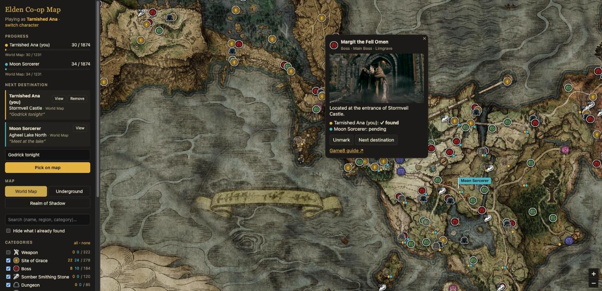
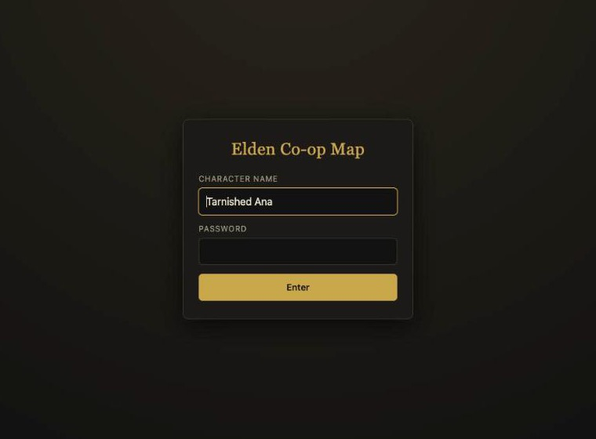
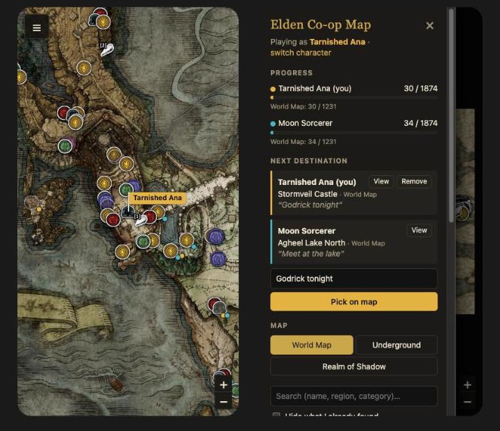

# Elden Co-op Map

Interactive Elden Ring map for co-op groups of up to six players. Each player marks what they find, sees the progress and next destination of everyone, and sets their own next destination on the map. Changes sync within a few seconds. Up to 20 spectators can watch without marking anything.

Built with **Next.js 16** (App Router), React 19, TypeScript, Leaflet (react-leaflet) and zustand. Pages and API live in a single project.

## Screenshots



| Login | Phone: full-screen map and the actions drawer |
| --- | --- |
|  |  |

The screenshots use demo data: two players with some Limgrave pins found and a next destination each.

## Getting started

```sh
npm install
cp .env.example .env    # set one password per player (2 to 6)
npm run dev             # http://localhost:3000
```

Open `http://localhost:3000`, enter a **character name** (any name, it can change on every login) and your **password**. The password decides which player slot you are.

To let other players join from their machines, run `npm run dev -- -H 0.0.0.0` and share `http://<your-ip>:3000`.

| Script | What it does |
| --- | --- |
| `npm run dev` | Development server |
| `npm run typecheck` | TypeScript type check |
| `npm test` | Tests for the binary sync format |
| `npm run build` | Production build |
| `npm start` | Serves the build (`-- -p 8080 -H 0.0.0.0` for another port or the network) |

## Configuration (`.env`)

| Variable | Purpose |
| --- | --- |
| `PLAYER1_PASSWORD` … `PLAYER6_PASSWORD` | Password of each player slot. Only slots with a password exist; all must be different |
| `SESSION_SECRET` | Optional extra secret for signing session cookies. Changing it logs everyone out |
| `TILE_URL` | Optional tile URL template (`{map}`, `{z}`, `{x}`, `{y}`). Defaults to `/tiles/{map}/{z}_{x}_{y}.jpg` |

Variables are only read on the server. None has the `NEXT_PUBLIC_` prefix, so they never reach the browser.

## Phones

On screens up to 800px wide the map takes the whole screen. Every action lives in a drawer opened with the button in the top-left corner; tap outside it, press × or start "Pick on map" to close it. Zoom controls sit at the bottom right, touch targets are at least 40px, inputs use 16px text so iOS does not zoom in, and the layout respects the notch and home indicator (`viewport-fit=cover` + `env(safe-area-inset-*)`).

## Login and session

- `/` is the login page. `/map` is the map and requires a session. Unknown routes return 404.
- `POST /api/login` checks the password (constant-time comparison) and sets an **httpOnly, signed session cookie** valid for 30 days. After 10 failed attempts from the same IP, login is blocked for 15 minutes.
- The character name is never sent to the login endpoint. It is stored in the browser and shared with the other players inside the sync snapshot.
- **Spectators** press "Watch as a spectator" on the login page: no name, no password. Anyone with the link can watch. They see the map, every player's progress and next destinations, but cannot mark anything; the server rejects any snapshot they send. Up to 20 spectators can watch at once (a seat frees up 20 seconds after one leaves). On Vercel the limit is counted per server instance, so it is approximate.
- "switch character" in the sidebar logs out, so you can log in again with another name. Your progress stays.
- The cookie is signed with a key derived from every password (plus `SESSION_SECRET`), so changing a password invalidates every session.

## Players panel

The **Players** section shows one card per player with their progress (total and current map) and their next destination: you, plus every player whose progress your browser has received. Pin badges, popups, category counts and map flags follow the same rule.

A player's data is **only replaced by a newer snapshot of that player**, never cleared: it stays when they disconnect, and when a poll lands on a server instance that does not know them. Players who are not syncing right now (not seen within the last 20 seconds) are labeled "offline".

## Where data lives (local-first)

- **Your progress lives in your browser** (`localStorage`). It is the only original copy and only you change it.
- **The server only relays.** It keeps each player's latest snapshot in memory so the others can see it, and tracks who is online. No database, no disk.
- If the server loses that memory (restart, deploy, another instance on Vercel), your browser notices on the next poll and sends your data again.
- **Other players' progress is cached** in your browser, so it is still there after they disconnect or the server forgets it.
- To avoid losing data when switching browsers or clearing site data, use **Backup → Export / Import** (JSON file). Importing merges the backup's pins with the ones you already have.

On Vercel, each request may hit a different instance, so presence and relayed snapshots are best effort. The client smooths this out: received progress is kept until a newer one arrives, and a player stays online until no instance has reported them for 20 seconds. A browser that never received a player's data (for example a new spectator) only sees it once a polled instance holds it, which happens as soon as that player syncs again.

## Sync format

A single route, `POST /api/sync`, with binary messages (`application/octet-stream`). The format is defined in `src/sync/` and shared by client and server:

- Each pin is identified by its position in the sorted catalog. Found pins travel as a **bitset** (1874 pins = 235 bytes at most) or as a **delta list** when there are few; the shorter one is picked automatically.
- Coordinates take 2 bytes each, integers are varints, and the character name and note are UTF-8.
- Every snapshot carries a hash of the catalog to detect different versions of `pins.json`.
- The server numbers stored snapshots with a sequence; each poll asks only for what changed since the last sequence it saw, plus a 1-byte bitmask of who is online. A server epoch tells clients when sequences started over.
- **An idle poll is about 13 bytes up and 14 down**, whatever the number of players. Your snapshot is only sent when it changed or when the server does not have it.

| Message | Measured size |
| --- | --- |
| Idle poll (measured with 3 players) | 13 B up / 14 B down |
| A change (1 pin + destination with a note) | ~45 B |
| Every pin found | ~245 B |

No compression (gzip/Brotli) is used: for messages this small, the compression header would be larger than the content. `pins.json` (static, ~700 KB) is compressed by the host and cached by the browser.

## Image caching

Game8 serves map tiles and popup images without `Cache-Control`, so browsers would only cache them heuristically. The app proxies them through its own origin:

- `/tiles/<map>/<z>_<x>_<y>.jpg` → Game8 map tiles
- `/game8-img/<jp|co>/…` → Game8 popup images (`pins.json` already points here)

Both respond with `Cache-Control: private, max-age=31536000, immutable`, so each image is downloaded once and then served from the browser cache, including on later visits. Only logged-in players can use the proxy, and only paths with the expected format are accepted.

To avoid depending on Game8 at all, `python3 scripts/download_tiles.py` downloads every tile into `public/map-tiles/` (about 4000 files). Then set `TILE_URL=/map-tiles/{map}/{z}_{x}_{y}.jpg`.

## Structure

```
src/
├── app/                          Next.js routes
│   ├── layout.tsx                base HTML and global styles
│   ├── page.tsx                  "/" → login (or /map if logged in)
│   ├── map/page.tsx              the map; requires a session
│   ├── not-found.tsx
│   ├── api/login, api/logout     session cookie
│   ├── api/sync/route.ts         binary snapshot exchange
│   ├── tiles/[map]/[tile]        cached proxy for map tiles
│   └── game8-img/[host]/[...path] cached proxy for popup images
├── server/                       server-only code (import 'server-only')
│   ├── config.ts                 reads and validates .env
│   ├── auth.ts                   password → player (constant-time)
│   ├── session.ts                signed session cookie
│   ├── loginRateLimit.ts         failed login attempts per IP
│   ├── http.ts                   withViewer(), HTTP errors, body readers
│   ├── imageProxy.ts             Game8 image proxy with immutable caching
│   ├── relay.ts                  latest snapshots, sequences and presence, in memory
│   └── syncCatalog.ts            pin catalog used to validate snapshots
├── sync/                         binary format shared by client and server
│   ├── binary.ts                 ByteWriter / ByteReader (varint, u16, u32…)
│   ├── catalog.ts                compact pin index + hash
│   ├── snapshot.ts               a player's progress ↔ bytes
│   ├── protocol.ts               /api/sync messages
│   └── sync.test.ts              tests (npm test)
├── features/                     frontend, by feature
│   ├── auth/                     login form
│   ├── player/                   player app shell (client only)
│   ├── coop/                     progress: store, localStorage, sync engine, presence, backup, names
│   ├── map/                      map, markers, popups, "pick on map" mode
│   ├── sidebar/                  sidebar panels
│   ├── pins/                     pin catalog and filters
│   ├── session/                  current player (or spectator) and profiles
│   ├── ui/                       UI state (map, filters, focus)
│   └── notifications/            toasts
├── api/                          typed HTTP clients for the frontend
├── shared/                       reusable components and utilities
├── config/constants.ts           constants shared by client and server
├── types/domain.ts               domain types
└── styles/global.css
public/
├── data/pins.json                pin catalog
└── icons/                        category icons
scripts/                          data generation
```

**Organization rules**

- `src/app` only contains routes. Logic lives in `server/`, `sync/` or `features/`.
- `server/` is never imported from the client; `server-only` makes the build fail if it happens.
- Each feature groups its components, hooks, stores and styles (CSS Modules). Features use each other only through their public hooks or stores.
- `config/constants.ts` does not import Leaflet because the server uses it too. Leaflet-dependent code lives in `features/map/`.
- The player app runs only in the browser (`PlayerAppLoader` with `ssr: false`) because Leaflet needs `window`.

**Extending it**

- **A new endpoint:** create `src/app/api/<name>/route.ts` wrapped in `withViewer(...)` (players and spectators; check `viewer.kind` for write access) and add a client in `src/api/`.
- **New synced data:** append it to `snapshot.ts`, bump `PROTOCOL_VERSION` in `protocol.ts`, and add a test to `sync.test.ts`.
- **A new page:** add a route under `src/app/`.

## API

| Method | Route | Body / response |
| --- | --- | --- |
| POST | `/api/login` | `{ "password": "…" }` → `{ "player": "p1" }`, or `{ "spectator": true }` (no password) → `{ "player": null }`; both set the session cookie |
| POST | `/api/logout` | Clears the session cookie |
| POST | `/api/sync` | Binary, see `src/sync/protocol.ts` and `src/sync/snapshot.ts` |

Errors are JSON `{ error }`: 400 invalid message, 401 not logged in or wrong password, 403 spectator tried to send progress, 409 catalog mismatch, 413 message too large, 429 too many login attempts, 503 spectator room full.

## Data

- `python3 scripts/build_pins.py [json]` regenerates `public/data/pins.json` and the icons from the Game8 map.
- `python3 scripts/download_tiles.py` downloads the tiles into `public/map-tiles/` (see "Image caching").

Map data and images belong to Game8 and FromSoftware. This project is for personal use only.
